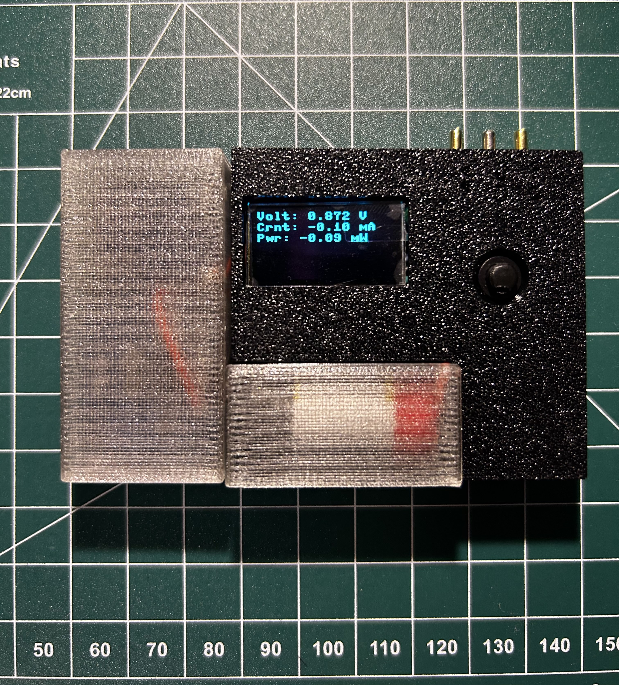
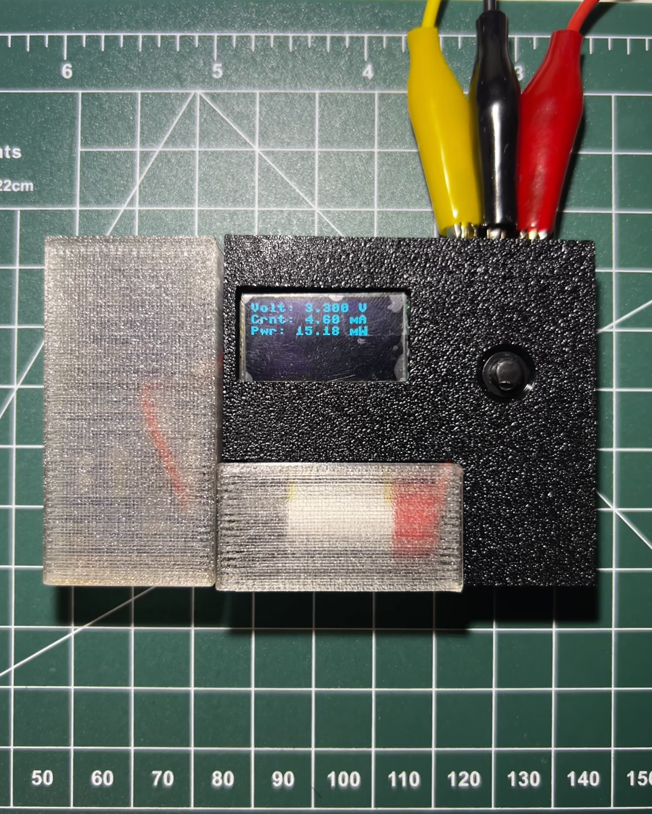
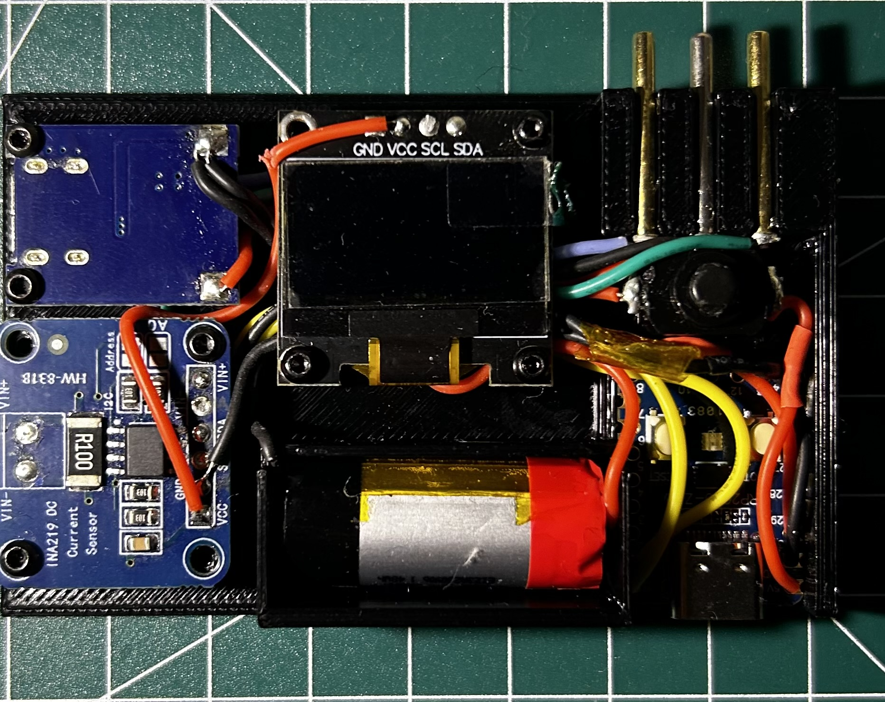

# PowerCard
<!-- Main Image -->

  

<table align="center">
  <tr>
    <td align="center" width="30%">
      
       <b>Vin = Left | GND = Middle | Vout = Right</b>
    </td>
    <td align="center" width="30%">
      
       <b>Internal Hardware</b>
    </td>
  </tr>
</table>

The **PowerCard** is among the smallest standalone power meters in the world. 

It is an embedded, pocketable digital power meter powered by the Raspberry Pi Pico (RP2040). It provides real-time high-side voltage, current, and wattage diagnostics rendered on an SSD1306 OLED display (128x64px), designed for rapid on-the-go bench testing of microcontrollers and low-power electronics.

The system utilizes an INA219 bi-directional current/power monitor IC over I2C to sample bus voltage and current across a shunt resistor. Powered by an integrated Li-Po cell paired with a TP4056 charging circuit and 5V step-up boost converter, the device delivers full standalone operation without requiring an external supply during testing.

| Parameter | Specification |
| :--- | :--- |
| **Microcontroller** | RP2040 (2MB FLASH) |
| **Sensor IC** | INA219 (I2C) |
| **Display** | 0.96" SSD1306 OLED (I2C) |
| **Power Management** | TP4056 w/ 5V Boost Converter |
| **Power Source** | 3.7V Li-Po Battery / USB Power |
| **Firmware Language** | MicroPython |
